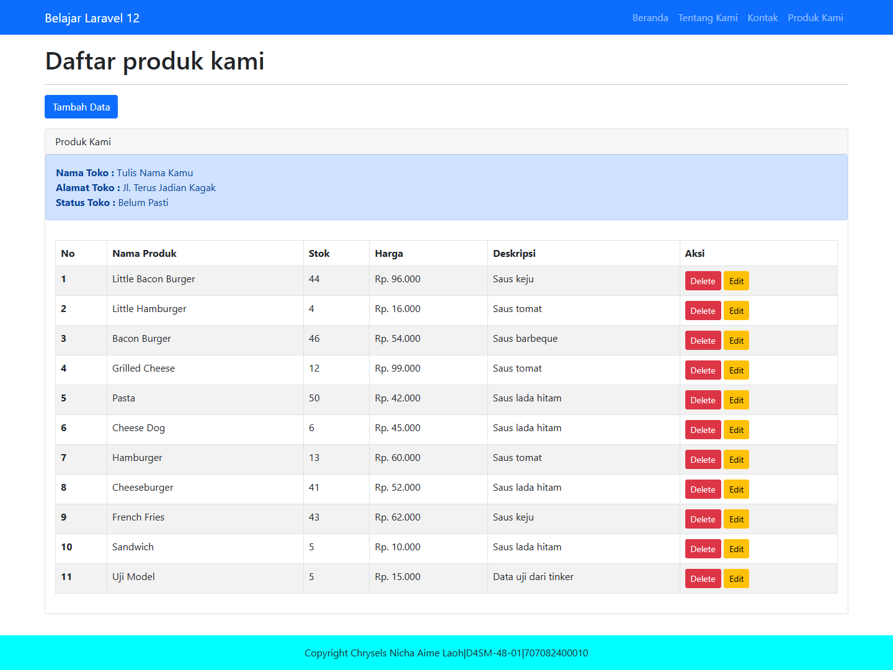
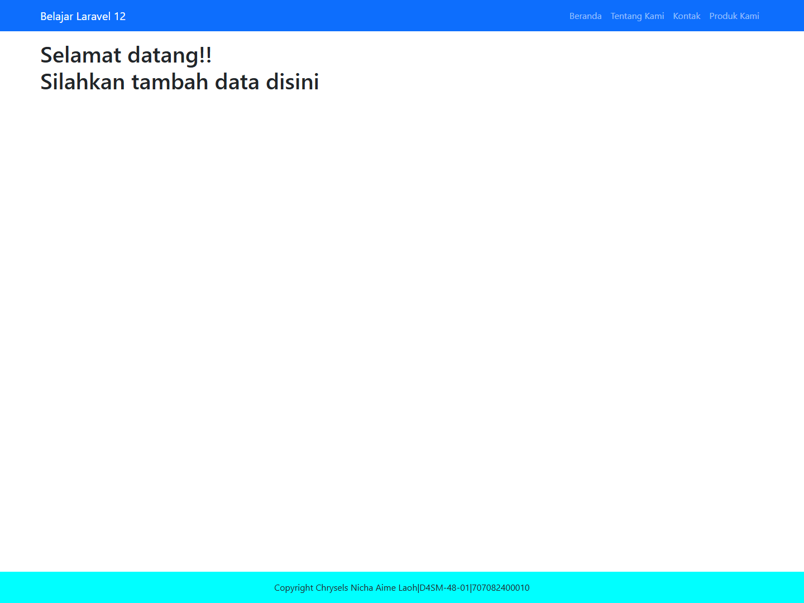

# Jawaban Praktikum Modul 8

## Nomor 1

Pada `resources/views/pages/product/show.blade.php`, isi kolom di dalam perulangan `@foreach ($data_produk as $item)` diubah menjadi:

```blade
<td>{{ $item->stock_product }}</td>
<td>Rp. {{ number_format($item->price_product, 0, ',', '.') }}</td>
<td>{{ $item->desc_product }}</td>
```

Stok dan deskripsi diambil dari atribut setiap produk yang dibaca dari database. `number_format()` menampilkan harga tanpa angka desimal, memakai koma sebagai pemisah desimal dan titik sebagai pemisah ribuan. Contohnya, nilai 96000 menjadi Rp. 96.000. Blade `{{ }}` juga melakukan escape teks saat ditampilkan.



## Nomor 2

### Kode Product.php

```php
<?php

namespace App\Models;

use Illuminate\Database\Eloquent\Model;

class Product extends Model
{
    protected $table = 'products';
    protected $primaryKey = 'id_product';
    protected $fillable = [
        'name_product',
        'stock_product',
        'price_product',
        'desc_product',
        'id_category',
    ];
}
```

- `$table` menentukan tabel database yang dipakai model. Jadi, operasi model Product diarahkan ke tabel `products`.
- `$primaryKey` menentukan kolom identitas unik setiap produk, yaitu `id_product`. Eloquent secara bawaan mencari kolom `id`, sehingga nama kunci ini perlu dinyatakan.
- `$fillable` menentukan kolom yang diizinkan menerima nilai sekaligus melalui array, misalnya pada `Product::create()`. Daftar ini membatasi atribut yang dapat diisi lewat mass assignment.

Penjelasan sesuai [dokumentasi Eloquent Laravel 12](https://laravel.com/framework/docs/12.x/eloquent).

### Pemindahan view

File `resources/views/pages/addProduct.blade.php` dipindahkan ke `resources/views/pages/product/addProduct.blade.php`. Method controller menjadi:

```php
public function addProduct()
{
    return view('pages.product.addProduct');
}
```

Route `/product` menggunakan method `index()`, yang membaca `Product::orderBy('id_product')->get()` dan mengirimkannya ke view `pages.product.show` sebagai `data_produk`.

### Pengujian Tinker

Perintah yang diuji melalui `php artisan tinker --execute`:

```php
App\Models\Product::count();
App\Models\Product::create([
    'name_product' => 'Uji Model',
    'stock_product' => 5,
    'price_product' => 15000,
    'desc_product' => 'Data uji dari tinker',
    'id_category' => 1,
]);
App\Models\Product::count();
```

Hasil nyata: jumlah awal 10, produk baru tersimpan dengan `id_product` 11, dan jumlah akhir 11. Hasil lengkap tersedia dalam `hasil-tinker.txt`. Screenshot terminal Tinker belum tersedia; berkas teks tersebut adalah keluaran asli perintah, bukan screenshot.

### Screenshot halaman

Halaman `/product` berhasil merespons HTTP 200 dan menampilkan baris **Uji Model**, stok **5**, harga **Rp. 15.000**, serta deskripsi **Data uji dari tinker**. Screenshot-nya ada pada Nomor 1.

Halaman `/product/addProduct` berhasil merespons HTTP 200 setelah pemindahan view:



Tampilan ini mempertahankan isi view Modul 7 yang berupa pesan tambah data. Form penyimpanan belum dibuat karena implementasi tersebut merupakan materi Modul 9.

## Catatan pelaksanaan

Folder Modul8 yang diberikan masih kosong. Implementasi dibuat dari salinan proyek `modul7-controller`, dengan database SQLite baru berisi 10 produk awal dari seeder dan 1 produk hasil Tinker. MySQL tidak sedang berjalan saat pengujian; database dan konfigurasi proyek Modul 7 tidak diubah. Seeder praktikum memakai Faker bawaan untuk variasi stok, harga, dan deskripsi serta daftar nama produk contoh.

Untuk menjalankan proyek hasil:

```powershell
cd 'D:\UNI Arc 3\PWI 2\Modul8'
php artisan serve
```

Lalu buka `http://127.0.0.1:8000/product` dan `http://127.0.0.1:8000/product/addProduct`.
